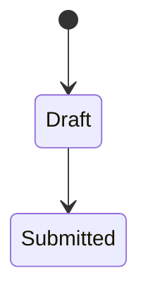

# Lifecycle: <object, e.g. Application>

## Statuses
| Code | User-facing name | Meaning | Owner (who acts next) | How the owner knows | Time limit / reminder | Exits |
|---|---|---|---|---|---|---|

## Transitions
| From → To | Triggered by (role or system) | Conditions | Side effects (notify, audit, money) | Reversible? |
|---|---|---|---|---|

## Diagram

## Checks
- [ ] Every status has an owner and a way out
- [ ] Every status has a user-facing explanation and next step
- [ ] Stalled states have reminders or escalation
- [ ] Rejections, cancellations and reversals carry a visible reason
- [ ] Money and decision transitions are audited
- [ ] The status name is the same in lists, detail pages, emails and reports
